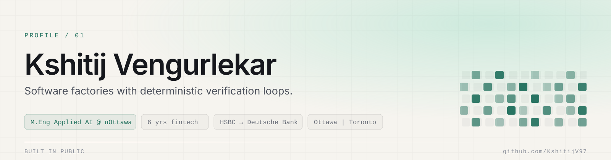

<p align="center">
  <picture>
    <source media="(prefers-color-scheme: dark)" srcset="./assets/banner-dark.svg">
    <source media="(prefers-color-scheme: light)" srcset="./assets/banner-light.svg">
    
  </picture>
</p>

<p align="center">
  <a href="https://kshitijv.vercel.app/"></a>
  <a href="https://www.linkedin.com/in/kshitijv97"></a>
  <a href="mailto:writetokshitij@gmail.com"></a>
  <a href="https://kshitijv.vercel.app/resume.pdf"></a>
</p>

I build agentic loops that ship code from ticket to deploy, and the checks that prove they did it right.

Six years at **HSBC** and **Deutsche Bank** (Corporate Bank and DWS) on payments, cash management and ETF platforms, where correctness wasn't optional. Now an M.Eng. in Applied AI at the **University of Ottawa**, applying the same discipline to coding agents.

> A system isn't done until you can prove it did what it claims. That matters more, not less, once AI is in the loop.

<sub>**Open to** Winter 2027 (Jan–Apr) and Summer 2027 (May–Aug) co-ops · Applied AI, ML engineering, AI platform · Ottawa, Toronto or remote</sub>

---

## How I build

Every repo below follows the same four steps. The agent writes the code. A deterministic check decides whether it ships.

```text
  spec  ──▶  agent  ──▶  guardrails  ──▶  deterministic check  ──▶  merge
  AGENTS.md  Claude Code   hooks, OPA,      tests, CI, parity
  ADRs       OpenCode      policy-as-code   and benchmark gates
             Antigravity
```

| Agent | Role in the loop | Where it shows up |
|:--|:--|:--|
| **Claude Code** | Primary agent. Each repo carries a `CLAUDE.md` contract, with project hooks and skills in `.claude/` | [craft-rail](https://github.com/KshitijV97/craft-rail) · [pursuit-kit](https://github.com/KshitijV97/pursuit-kit) · [discover-tarkarli](https://github.com/KshitijV97/discover-tarkarli) · [ai-powered-data-governance](https://github.com/KshitijV97/ai-powered-data-governance) |
| **OpenCode** | Open-source (MIT) agent that runs from the same `AGENTS.md` contract, so specs aren't tied to one vendor | [pursuit-kit](https://github.com/KshitijV97/pursuit-kit) (`opencode.json`) |
| **Antigravity** | Google's agent-first IDE, working from the same `AGENTS.md` rules | `AGENTS.md` in [craft-rail](https://github.com/KshitijV97/craft-rail) · [vouchor](https://github.com/KshitijV97/vouchor) |
| **CraftRail** | My own agent-neutral framework that keeps requirements, ADRs and verification evidence in step | [craft-rail](https://github.com/KshitijV97/craft-rail) |

Agent-written commits carry a `Co-Authored-By` trailer, so you can check which code came from an agent instead of taking my word for it.

## Live evidence

<!-- METRICS:START -->
| Signal | Value | Measured as |
|:--|:--|:--|
| Commits to my public repos, last 12 months | **188** | <sub>author = me, non-fork repos</sub> |
| …of which written with a coding agent | **115** (61%) | <sub>commit carries a `Co-Authored-By` trailer naming the agent</sub> |
| Active repos with an agent contract | **5 AGENTS.md** · **8 CLAUDE.md** | <sub>file at repo root</sub> |
| Repos configured for Claude Code / OpenCode / Antigravity | **8** / **1** / **0** | <sub>`CLAUDE.md`·`.claude/` / `opencode.json`·`.opencode/` / `.agent/`·`GEMINI.md`</sub> |
| Active repos gated by CI | **11** of 12 (23 workflows) | <sub>`.github/workflows/*.yml`</sub> |
| Active repos under an OSI-approved licence | **10** of 12 | <sub>GitHub-detected SPDX id</sub> |
| Repos with commits in the last 90 days | **11** | <sub>of 73 public originals</sub> |

<sub>Regenerated daily from the public GitHub API by [`update_metrics.py`](scripts/update_metrics.py) · last run 2026-11-25 12:28 UTC · "active" = a non-licence commit in the last 12 months</sub>
<!-- METRICS:END -->

## Career numbers

| | |
|:--|:--|
| **6 yrs** | shipping production fintech at two global banks |
| **3** | products taken from blank page to production · **2** legacy platforms modernised |
| **2** | first corporate clients taken live on dbFrontier, a cash-management SaaS on Cloud Run |
| **≈ $30K** | in licence costs removed by replacing the paid AG Grid dependency with a headless data grid I wrote |
| **~20 min** | single-click Jenkins release pipeline at HSBC, replacing a manual process |
| **Grad cohort** | taught advanced programming in Deutsche Bank's graduate-hire curriculum |

---

## Selected work

| Project | What it proves | Number |
|:--|:--|:--|
| **[SwinUNETR → ONNX → TensorRT](https://github.com/KshitijV97/swinunetr-spleen-tensorrt)**<br><sub>PyTorch · MONAI · ONNX · TensorRT · CUDA</sub> | 3D spleen segmentation in CT, exported behind a parity check and compiled to an FP16 engine on a T4 | **5.58×** faster than PyTorch FP32, same Dice |
| **[AI data governance for PIPEDA](https://github.com/KshitijV97/ai-powered-data-governance)**<br><sub>Python · OpenMetadata · Presidio · MCP</sub> | AI-assisted metadata for a synthetic Canadian bank, with an MCP assistant for privacy questions | PII F1 **0.78 → 0.94** on 145 labelled columns |
| **[Pursuit Kit](https://github.com/KshitijV97/pursuit-kit)**<br><sub>TypeScript · Hono · Cloudflare Workers · Playwright</sub> | Tailored résumés where every claim traces back to recorded evidence | **5** CI workflows gate every change |
| **[CraftRail](https://github.com/KshitijV97/craft-rail)**<br><sub>Python · ADRs · GitHub Actions</sub> | Git-native, agent-neutral framework for humans and agents building together | MIT |
| **[Vouchor](https://github.com/KshitijV97/vouchor)**<br><sub>Python · Ollama · LLM agents</sub> | Self-hosted assistant where every action is checked, approved and proven after it runs | AGPL-3.0 · design stage |
| **[GCP Fintech Playbook](https://github.com/KshitijV97/gcp-fintech-architecture-playbook)**<br><sub>Terraform · Google Cloud · OPA</sub> | One GDPR fraud platform built four ways, extended to PIPEDA, with policy-as-code | **4** reference architectures |
| **[Between Us](https://github.com/KshitijV97/between-us)**<br><sub>Go · React · SQLite · OpenTelemetry</sub> | Local-first: chat exports become metrics and cited answers, and nothing leaves the machine | **4** CI workflows |

<details>
<summary><b>More work</b>: smart-grid forecasting, a booking engine, hackathons, and a learning log</summary>

<br>

`smart-grid-analytics`: next-day Ottawa load forecasting (XGBoost, Go, Terraform) ·
`discover-tarkarli`: a live booking platform where a Postgres exclusion constraint makes double-booking impossible ·
`dev-platform`: a zero-cost Canadian dev platform on Oracle Always Free ·
`ai-powered-chatbot-voiceflow`: agentic cash-management Q&A over ISO 20022 statements, on self-hosted ERPNext and Firefly III ·
plus 22 practice repos, kept in the [learning log](https://kshitijv.vercel.app/learning) for honesty rather than as portfolio pieces.

</details>

---

## Free and open-source software

I default to software that users can read, run, change and self-host.

- **Licensing:** my repos are released under OSI licences, with **Apache-2.0** as the default. [Vouchor](https://github.com/KshitijV97/vouchor) uses **AGPL-3.0** so hosted forks stay open too, and [CraftRail](https://github.com/KshitijV97/craft-rail) and the [GCP playbook](https://github.com/KshitijV97/gcp-fintech-architecture-playbook) use **MIT**.
- **Local-first and self-hosted:** Vouchor runs on local models through Ollama, Between Us keeps your chats on your machine, and the cash-management agent runs on self-hosted ERPNext and Firefly III.
- **Built on open tools:** PyTorch, MONAI, ONNX, OpenMetadata, Presidio, OpenTelemetry, PostgreSQL, SQLite, Go, Linux. I've self-hosted mail, chat, storage and monitoring on bare metal with Ansible, Traefik and WireGuard.
- **Agent-neutral by design:** specs live in plain `AGENTS.md` and ADRs, so an open-source agent like OpenCode can do the same job as a proprietary one.

---

## Experience

| When | Role | Where |
|:--|:--|:--|
| Sep 2026 – now | M.Eng., Electrical & Computer Engineering (Applied AI) | University of Ottawa |
| Mar 2026 – Jul 2026 | Assistant Vice President | Deutsche Bank · DWS (Xtrackers ETFs) |
| Jun 2022 – Mar 2026 | Associate Software Engineer | Deutsche Bank · embedded finance (Synthix, dbFrontier) |
| Mar 2021 – Jun 2022 | Software Engineer | HSBC |
| Sep 2020 – Mar 2021 | Trainee Software Engineer | HSBC |

**Languages** `Java` `Go` `TypeScript` `Python` `SQL`
**AI / ML** `PyTorch` `MONAI` `CUDA` `TensorRT` `ONNX` `RAG` `MCP` `agents`
**Backend & data** `Spring Boot` `gRPC` `event-driven` `PostgreSQL` `Data Vault 2.0`
**Cloud & platform** `Google Cloud` `Cloud Run` `Pub/Sub` `Kubernetes` `Terraform` `Docker` `GitHub Actions`
**Frontend** `React` `micro-frontends` `Vite` `Storybook` `WCAG 2.0 AA`

---

<p align="center">
  <sub><b>Ottawa | Toronto</b> · <a href="mailto:writetokshitij@gmail.com">writetokshitij@gmail.com</a> · <a href="https://kshitijv.vercel.app/">kshitijv.vercel.app</a> · <a href="https://calendly.com/writetokshitij/15min">book 15 minutes</a></sub>
</p>
